<p align="center"></p>

(support Pohko on Pumpfun: 4JvkFc6sdU224MEtzJrxisVd3wPcmAU2N4cP9QJnpump)

# Pohko

### Keep the reason.

**A memory for positions on Solana.**

Pohko keeps the reason behind a position, the conditions that reason depends on and the evidence that arrives afterwards. It gives each change a place in the record, then prepares a source-linked case for a Grok Bot research workflow.


The first question is simple: **does the reason I entered still hold?**

A chart can move while that answer changes. A new story can replace the old one in your head. An observation can become stale. Pohko puts those details on the page: an original entry, a small set of explicit conditions and an attributed history of what happened next.

| Release | Journal | Interface | Grok Bot workflow |
|---|---|---|---|
| 0.1.0 | Linked event history; owner-controlled files | 12 views; offline and local-server editions | Operator instructions, review packets and reusable task wording |

[Start here](QUICKSTART.md) · [Methods](METHODS.md) · [Grok Bot setup](GROKBOT-SETUP.md) · [Full image atlas](SCREENSHOTS.md) · [Upload instructions](GITHUB-UPLOAD.md)

## Open the folio

Download and extract the repository. Open **`Pohko.html`** for the self-contained edition. Its journal, interface and artwork are embedded in one file.

For the modular source edition, use Node.js 20+:

```sh
npm start
```

Open `http://127.0.0.1:4174`. No package installation is needed for the journal, tests, receipts or build. `index.html` uses this server; `Pohko.html` also works as a local file.

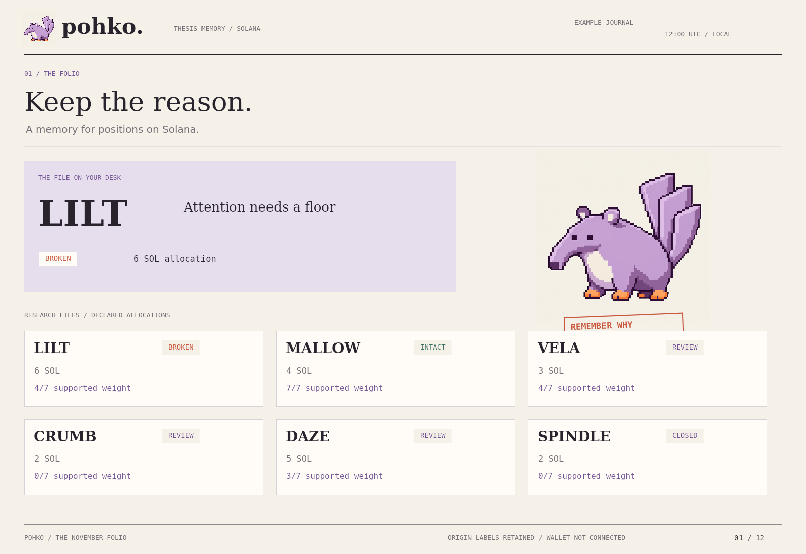

The supplied **reference journal** contains six fictional asset files and 80 authored events. It makes the rules inspectable: a broken depth floor, a healthy condition set, conflicting sources, expired evidence, a revision and a closed file. These records are examples, not a market feed or a report of executed positions. Their origin remains visible in the interface and exports.

Start a **New empty journal** to record your own entries. The app supports new files, evidence, reason revisions, owner reviews, closure, JSON import and export. Changes are saved in your browser when storage is available. Export a backup when the record matters.

## Record the reason before the rewrite

An entry contains an asset label, a short title, an original reason, a declared allocation in SOL and one to three testable conditions. The allocation is a journal field; Pohko does not submit an order.

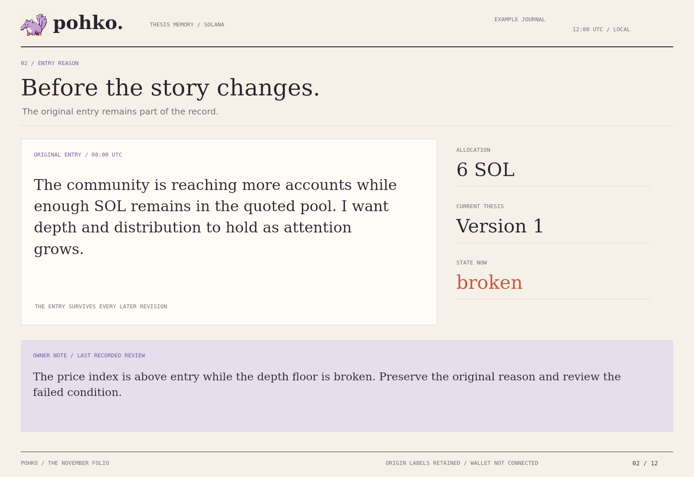

The original reason remains in the opening event. A later amendment records a new version and an explanation. It does not replace the opening bytes. Closed files retain their history and reject new events through the append API.

This distinction makes the file useful after your interpretation has changed. You can read what you actually wrote, when you wrote it and why a new version was introduced.

## Say what must remain true

Each condition declares a measured quantity, comparator, threshold, unit, positive weight, freshness window and critical flag. Evidence supplies the value and its source.

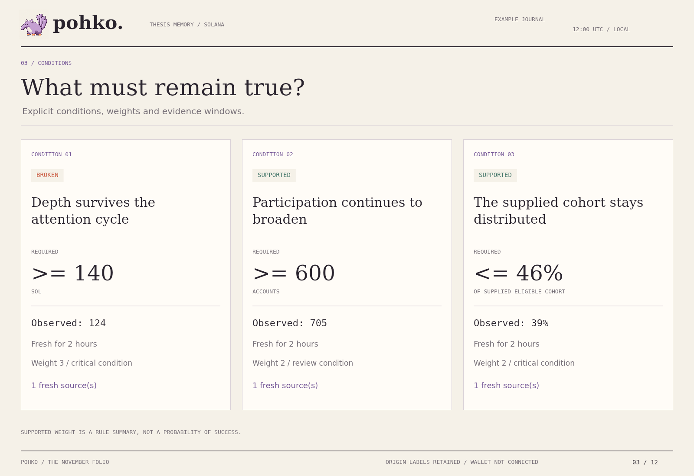

The reference LILT file declares:

| Condition | Requirement | Weight | Fresh for | Critical |
|---|---:|---:|---:|---|
| Quote reserve | At least 140 SOL | 3 | 2 hours | Yes |
| Active accounts | At least 600 | 2 | 2 hours | No |
| Top-ten supplied cohort share | At most 46% | 2 | 2 hours | Yes |

These are owner-declared criteria for this file. They are not universal market thresholds. Cohort concentration needs its own denominator and coverage statement; account counts do not identify independent people.

Condition states are `supported`, `broken`, `contested`, `stale` or `unobserved`. The file summary is `intact`, `broken`, `review` or `closed`. A critical broken condition makes the file broken; any unresolved condition otherwise sends it to review. These states describe the recorded thesis and do not issue a buy or sell instruction. [Condition methods](CONDITIONS.md) define the boundaries.

## Evidence has an address in the file

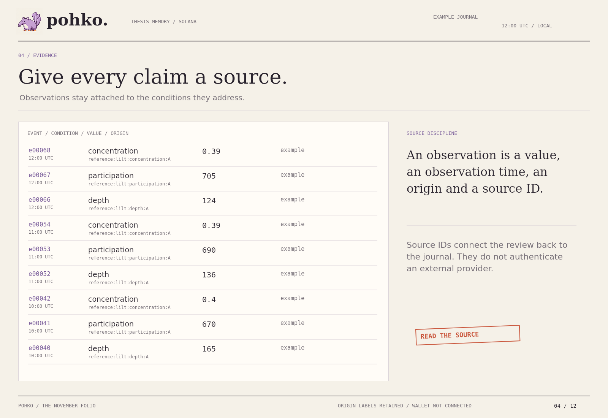

An observation records a value, source ID, observation time, origin and contextual note. Pohko preserves when it was observed separately from when it entered the journal. The review cutoff includes only events recorded at or before that time.

For each condition, the most recent observation time from each source is considered; a later record breaks an observation-time tie. A delayed older observation cannot displace a newer one from that source. Freshness uses the observation time, not the time the note happened to arrive.

Source IDs establish traceability inside the supplied record. They do not authenticate an external provider. [Evidence rules](EVIDENCE.md) explain origins, coverage and conflicting measurements.

## The chart and the reason can part ways

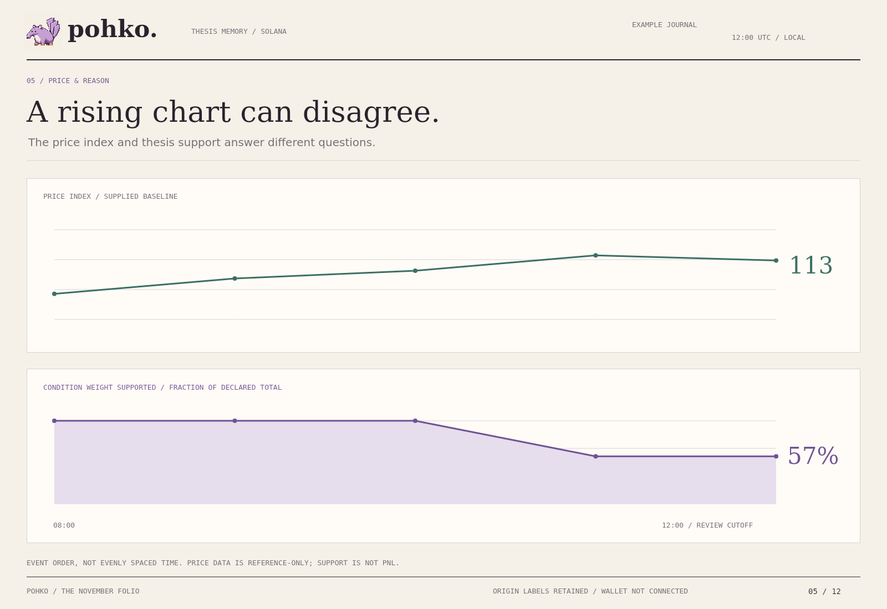

In the LILT reference file, the latest price index is **113**, with entry set to 100. The reserve observation has meanwhile fallen to **124 SOL**, below the declared 140 SOL floor. Participation and concentration still pass, leaving **4 of 7 condition weight supported**.

The two plotted series answer different questions. Price is a supplied reference index. Supported weight is the sum of condition weights with fresh, agreeing, passing evidence divided by all declared condition weight. It is neither PnL nor a probability of success. Observations are plotted by event-group order, not evenly spaced elapsed time.

## Keep disagreement on the page

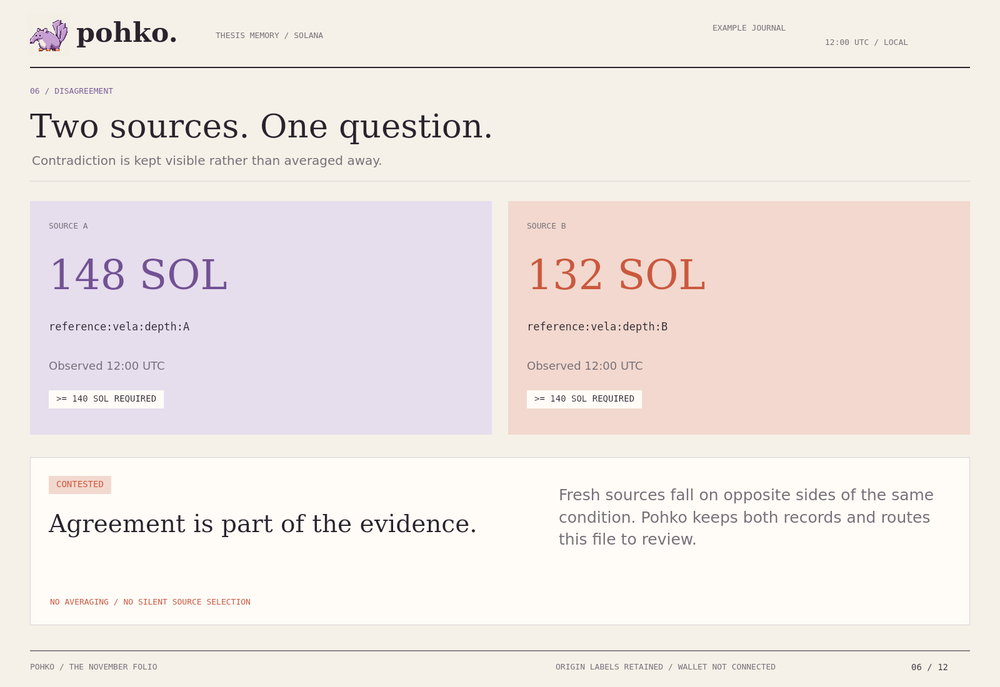

The VELA example has two fresh sources on opposite sides of the same depth floor: **148 SOL** and **132 SOL**. Pohko marks the condition contested. It retains both source records and sends the file to review.

There is no source voting, weighted average or automatic preference for the number that supports the position. Agreement means all considered fresh sources land on the same side of the declared comparator. A source ID is a label, not proof that two feeds are independent.

## A revision is a new event

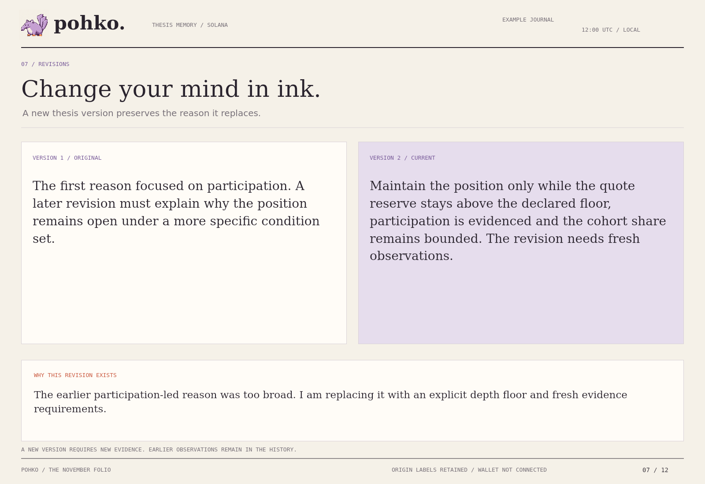

The DAZE file narrows its original reason. Version two includes the explanation and the new thesis. Evidence from before that version is kept in the history but does not support its conditions. Fresh post-revision observations must establish support again.

The browser revision form changes the reason while retaining the current condition definitions. Full condition changes are supported through the journal API and validated imports. [Versioning](VERSIONS.md) explains identity, evidence reset and closure.

## Old evidence should look old

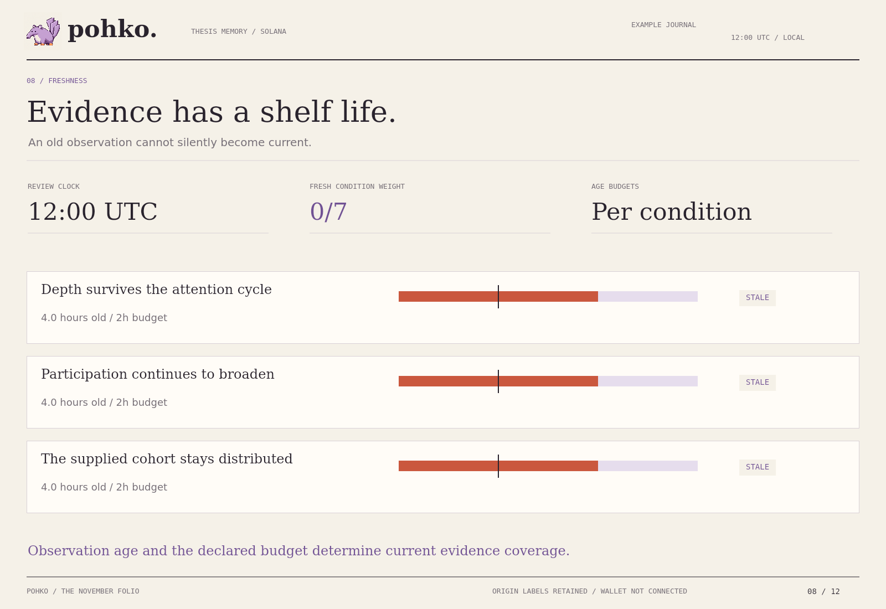

CRUMB's evidence ends at 08:00 UTC. At the 12:00 review cutoff, all three observations are four hours old against a two-hour budget. They remain readable, but none counts as current support.

An observation exactly at its age budget is fresh. It becomes stale after that boundary. Missing evidence is shown as unobserved. Pohko does not substitute price movement for a missing condition measurement.

## Preserve the sequence

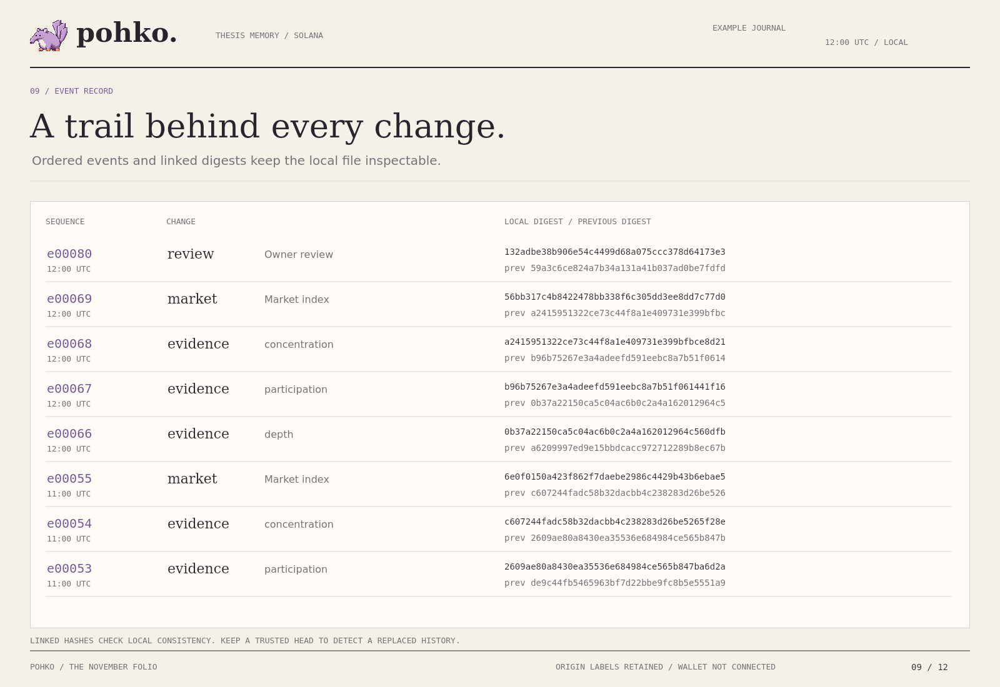

Each event contains a sequence number, thesis ID, event kind, UTC timestamp, body, previous digest and SHA-256 digest. New events link to the previous journal head. The verifier checks the order, payload, chronology and local digest chain before an import is accepted.

```sh
npm run verify
node cli.mjs verify reference-journal.json
```

The local chain establishes consistency against supplied bytes. It does not authenticate an author or establish on-chain existence. A replaced history can be rehashed. Keep a trusted head outside the mutable file when you need to detect replacement or truncation. Journal name and origin are envelope labels outside the event head. [Integrity](INTEGRITY.md) defines exactly what is covered.

## Give Grok Bot the case, not a vague memory

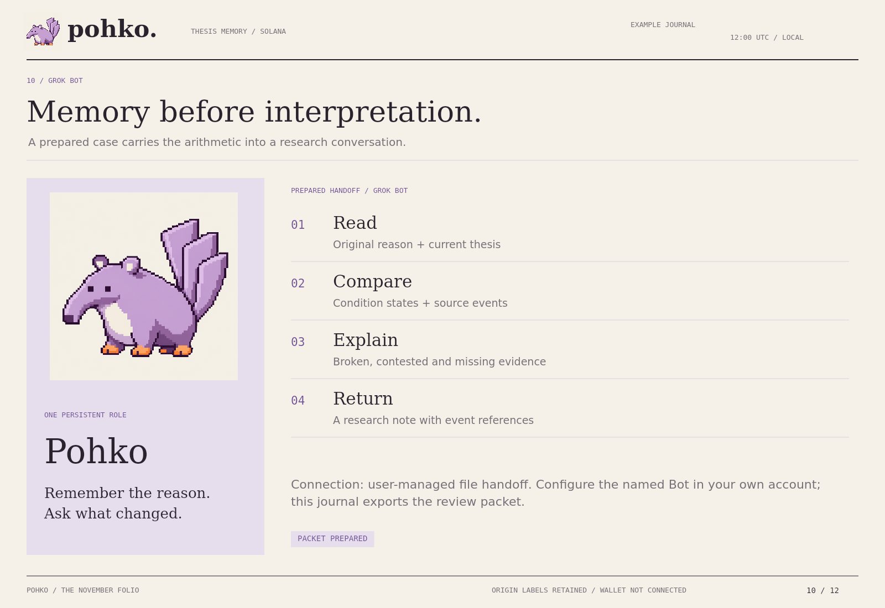

The repository supplies an original **Pohko operator pack** for the user's Grok Bot account:

- [Operator role](GROKBOT-OPERATOR.md): retain the entry reason, inspect the current conditions and explain measured changes.
- [Single-review task](GROKBOT-REVIEW.md): turn a prepared review packet into an attributed research note.
- [Repeatable review wording](GROKBOT-ROUTINE.md): configure a recurring pass after a successful manual review.
- [Setup guide](GROKBOT-SETUP.md): choose the named Bot, provide the files and validate the result.

The connection is a **user-managed file handoff**. Export Review JSON and provide it with the role instructions in your configured Grok Bot conversation. The pack does not install an account connection or a routine merely by being uploaded to GitHub. Interpretation returned by Grok Bot remains separate from the local rule evaluation and owner-authored journal history.

## Export the record behind the review

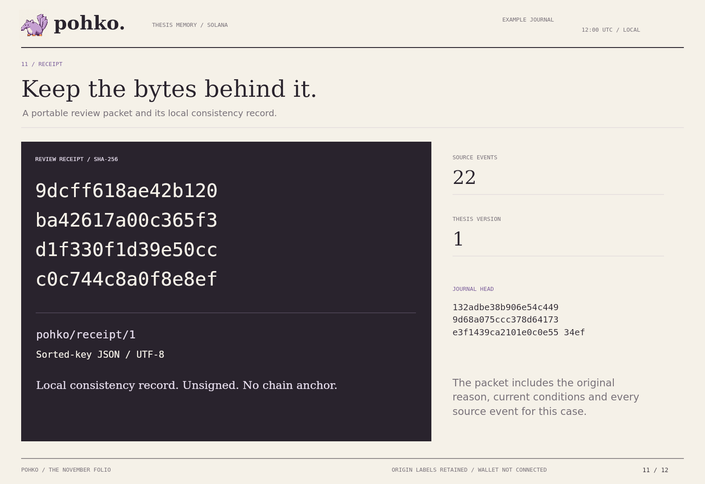

Pohko exports the full journal, a review packet, a receipt, a deterministic research note and the current 1600 × 1100 view. A receipt includes the packet and a digest of sorted-key JSON encoded as UTF-8 without a trailing newline.

```sh
node cli.mjs receipt reference-journal.json lilt
node cli.mjs note reference-journal.json lilt
```

The generated Markdown note is a local report, not a claimed provider response. The receipt remains unsigned and unanchored. No wallet or external feed is connected by the shipped interface.

## Put unresolved files first

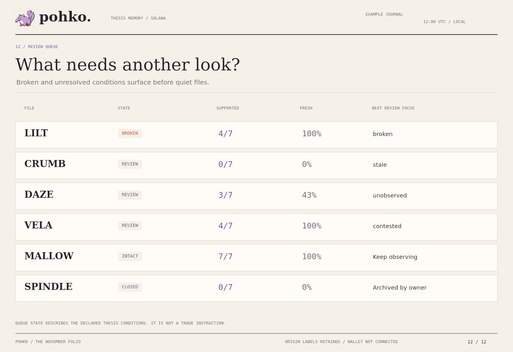

The queue sorts broken files first, followed by review, intact and closed files. Within a group, thesis IDs provide a stable order. Each row keeps supported weight, fresh evidence coverage and the next unresolved state visible. The queue does not rank returns or token quality.

## Reproduce and extend

```sh
npm run data
npm run build
npm test
npm run check
npm run integrity
```

The core uses the JavaScript standard library and Web Crypto. PNG regeneration optionally uses a native Canvas renderer and local DejaVu fonts. The prepared release was checked with Node.js 24.22.1. See [reproducibility](REPRODUCIBILITY.md), [architecture](ARCHITECTURE.md) and [API examples](API.md).

All twelve figures are direct renderings of the same drawing functions used by the local interface. Their records, values and source IDs are available in this repository. The mascot is original generated artwork; its prompt and generation mode are recorded in [provenance](PROVENANCE.md).

## One folder, complete upload

Every file in this package is at the repository root. The logo, cover and numbered PNGs sit beside `README.md`. Extract the ZIP, open the inner `pohko` folder and upload all files together. [GitHub upload guide](GITHUB-UPLOAD.md).

| Files | Role |
|---|---|
| `journal.mjs`, `hash.mjs` | Validated append operations, canonical bytes and linked history |
| `evaluate.mjs`, `packet.mjs` | Conditions, review queue, packets, receipts and local notes |
| `views.mjs`, `paint.mjs` | Twelve notebook compositions |
| `app.mjs`, `index.html`, `style.css` | Browser controls, local storage and import/export |
| `Pohko.html` | Self-contained offline journal |
| `reference-*.json` | Complete example journal and derived outputs |
| `GROKBOT-*.md` | Original operator role and review workflow |
| `*.test.mjs` | Integrity, condition, cutoff, packet and interface checks |
| Uppercase Markdown files | Methods, data contracts, operation and contribution guidance |
| `pohko.png`, `pohko-cover.png`, numbered PNGs | Original identity and all twelve views |

Pohko's name nods to Proof of History; its local hash-linked journal is its own application record. It does not implement Solana consensus. [Source notes](SOURCES.md), [privacy](PRIVACY.md) and [roadmap](ROADMAP.md) describe the surrounding boundaries.

Original Pohko code, documentation and supplied artwork. [MIT license](LICENSE).
